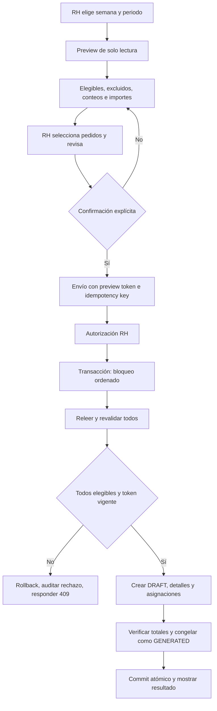

# YellowFlex Food Services — Diseño técnico del Bloque 2

**Alcance:** generador transaccional de lotes oficiales de nómina.  
**Estado:** propuesta, no implementada.  
**Fecha:** 18 de noviembre de 2026.

Este documento diseña la creación de lotes oficiales desde pedidos ordinarios, con snapshots y asignaciones activas. No incluye implementación, migraciones, exportación oficial ni conciliación.

## A. Arquitectura propuesta

Separar el Bloque 2 en cuatro componentes:

1. **Vista previa de solo lectura:** consulta pedidos de una semana de servicio, aplica elegibilidad y muestra elegibles, excluidos y agregados. No crea lote ni reserva pedidos.
2. **Confirmación RH:** envío explícito de la selección revisada, con token efímero de preview y clave de idempotencia.
3. **Servicio transaccional:** revalida permisos, bloquea pedidos ordenadamente, vuelve a evaluar elegibilidad y crea lote, snapshots y asignaciones en una única transacción.
4. **Persistencia de idempotencia y auditoría:** conserva los parámetros y respuesta de solicitudes exitosas; registra intentos autorizados rechazados fuera de la transacción fallida.

Reutilizar evaluateFoodPayrollEligibility de payroll-eligibility.ts como regla pura. Añadir una consulta masiva para cargar pedidos, empleado, semana, reservas y asignaciones en vez de ejecutar una consulta por pedido. Las escrituras deben operar solo con el cliente transaccional Prisma.

No reutilizar getHrBillingSummary ni el exportador informativo como generador: esos servicios reportan pedidos, no reservan ni asignan pedidos.

Servicios propuestos:

- previewFoodPayrollBatch(client, params): query read-only y agregados.
- createFoodPayrollBatch(actor, request): autorización, bloqueo, revalidación, snapshots, asignaciones, auditoría e idempotencia.
- loadPayrollCandidates(client, serviceWeekId): query masiva interna.
- toPayrollBatchSnapshot(order, employee, reservations, payrollPeriod): normalización pura de Decimal a centavos/decimal.

Errores tipados: PREVIEW_EXPIRED, ORDER_NOT_ELIGIBLE, ACTIVE_ASSIGNMENT_EXISTS, IDEMPOTENCY_KEY_REUSED, EMPTY_SELECTION, BATCH_CONFLICT y error temporal de transacción.

## B. Flujo funcional

Preview debe mostrar semana, periodo, empleados/números, cantidad, precio histórico e importe por pedido; pedidos excluidos con códigos y causas; y totales de los pedidos elegibles seleccionados: pedidos, empleados distintos, servicios e importe. Mostrar que el resultado se volverá a validar al confirmar.

Mantener preview temporal y no persistida. Una fila DRAFT abandonada no debería reservar pedidos. El previewToken firmado por servidor debe vincular actor, menuWeekId, periodo, IDs elegibles, huella de datos relevantes y expiración breve. Es una protección de integridad de la selección mostrada, no sustituye la revalidación transaccional.

## C. Transacción y concurrencia

El contrato con cancelFoodOrder es bloquear primero la fila FoodOrder. La cancelación ya ejecuta SELECT FOR UPDATE y luego consulta asignaciones en su misma transacción. El creador debe respetar el mismo orden.

Secuencia:

1. Validar estructura, límite de cantidad, IDs únicos y header Idempotency-Key.
2. Validar RH/grant; dentro de transacción volver a comprobar cuenta, rol y permiso.
3. Buscar la clave idempotente existente. Igual actor y huella devuelve respuesta almacenada; diferente actor/parámetros produce 409.
4. Abrir transacción Serializable, con pocos reintentos acotados para errores de serialización. Cualquier reintento debe volver a ejecutar todo, incluyendo autorización y elegibilidad. Un diseño ReadCommitted con bloqueos y relecturas también podría funcionar, pero Serializable es la recomendación para revisión de nómina.
5. Ordenar los orderIds de forma determinista y bloquear las filas en ese orden usando SELECT id FROM FoodOrder WHERE id = ANY(...) ORDER BY id FOR UPDATE. Confirmar que se encontraron todas.
6. Volver a cargar dentro de la transacción pedido, empleado, semana, reservas, departamento/turno y asignaciones ACTIVE.
7. Revalidar todos los pedidos. Si alguno falta, se cancela, cambia de estado/semana, tiene asignación, reserva incoherente o deja de ser elegible, revertir todo y responder 409 con razones por pedido. No eliminar silenciosamente filas de un lote confirmado: solicitar nuevo preview y confirmación.
8. Rechazar selección vacía. Calcular importes como centavos enteros.
9. Crear FoodPayrollBatch como DRAFT dentro de la transacción.
10. Crear un FoodPayrollBatchItem por pedido, snapshots y una FoodPayrollAssignment ACTIVE por detalle.
11. Verificar que detalles, asignaciones, empleados distintos, servicios y totales coincidan con lo calculado.
12. Actualizar lote a GENERATED, generatedAt, conteos/total y respuesta idempotente.
13. Commit único. Cualquier error previo revierte lote, detalles, asignaciones y respuesta.

No actualizar FoodOrder.payrollStatus, payrollExportedAt ni payrollExportedById. Incluir en lote no equivale a exportar o procesar.

### Intercalaciones relevantes

| Caso | Resultado con el protocolo |
|---|---|
| Generador bloquea primero | Cancelación espera; después ve asignación ACTIVE y rechaza. |
| Cancelación bloquea primero | Generador espera; al continuar relee CANCELLED y falla elegibilidad. |
| Dos generadores solapados | Bloquean pedidos en el mismo orden; el segundo vuelve a evaluar y ve asignación activa. |
| Dos generadores disjuntos | Pueden seguir en paralelo. |
| Escritor futuro ignora el bloqueo | La aplicación no garantiza serialización con cancelación. El índice parcial solo evita dos asignaciones ACTIVE; no impide asignar un pedido cancelado. |

El índice parcial es la última barrera ante duplicidad de asignación. SQLSTATE 23505 / Prisma P2002 atribuible al índice debe revertir toda la transacción y convertirse en 409 ACTIVE_ASSIGNMENT_EXISTS. No reintentar sin preview y reevaluación. Timeouts o respuesta HTTP perdida se resuelven repitiendo la misma clave de idempotencia.

## D. Idempotencia

FoodPayrollBatch ya declara idempotencyKey única global, pero no guarda huella de parámetros ni la respuesta original. Clave sola no detecta reutilización con otra selección.

Propuesta:

- Cliente genera UUID aleatorio al confirmar y envía Idempotency-Key. No derivarlo de semana/periodo: dos lotes intencionales pueden compartir parámetros.
- Alcance global, consistente con la unicidad actual.
- Huella SHA-256 canónica incluye actor, versión del contrato, serviceWeekId, periodo exacto, IDs seleccionados ordenados y digest del preview.
- Añadir campos idempotencyRequestHash y idempotencyResponse JSON/jsonb versionada al lote, o tabla de idempotencia equivalente. Persistir junto al lote dentro de la transacción.
- Respuesta estable guardada: batchId, estado, semana, periodo, orderIds, conteos y total.
- Misma clave + mismo actor/hash: replay exacto (200); misma clave con otro actor/hash: 409 IDEMPOTENCY_KEY_REUSED.
- Si hay inserción simultánea, la unicidad hace esperar al segundo escritor. Tras P2002, consultar el lote confirmado fuera de la transacción abortada y comparar la huella.

Esto es independiente del índice de asignación: idempotencia evita repetir una solicitud; la unicidad parcial evita que el mismo pedido esté asignado dos veces.

Para solicitudes autorizadas rechazadas o vacías, proponer FoodPayrollBatchAttempt append-only con actor, fecha, semana, periodo, hash de selección, cantidad, outcome (CREATED, REPLAYED, REJECTED, EMPTY), código de razón y batchId nullable. Para errores de negocio, escribir el evento después del rollback en una transacción aparte. No almacenar PII o payload arbitrario duplicado. No crear lote vacío para representar intento.

## E. Contrato API y autorización

### Preview

POST /api/food-services/hr/payroll-batches/preview

Entrada: serviceWeekId, payrollPeriod. Respuesta 200: previewToken, expiración, parámetros, elegibles, excluidos con razones estables y agregados. Solo lectura; no asigna ni crea lote.

### Confirmar

POST /api/food-services/hr/payroll-batches  
Header: Idempotency-Key: UUID

Entrada: serviceWeekId, payrollPeriod, previewToken, orderIds.

- 201: lote nuevo GENERATED.
- 200: replay con la respuesta guardada.
- 400: forma inválida, IDs repetidos o clave inválida.
- 401/403: autenticación/autorización.
- 409: preview expirado, pedido cambió, selección vacía, asignación existente o clave reutilizada con otros parámetros.
- 503/504: fallo temporal; repetir con la misma clave.

Autorización actual reutilizable para lectura es requireFoodServicesRhAccess: permite ADMIN o RH con manage de Food Services. Para confirmar dinero/lotes recomiendo una acción C-PANEL específica create-payroll-batch, además de rol RH y autorización base; no reutilizar manage sin una decisión de mínimo privilegio. Revalidar grant dentro de transacción como hace la cancelación. La acción no existe hoy: requiere aprobación y cambios de catálogo/grant posteriores. No se alteran permisos en este diseño.

Actor de confirmación: createdById existente y timestamp createdAt/generatedAt. Motivo opcional del lote requiere decisión RH; motivo de anulación sí debe ser obligatorio. Registrar actor/fecha/parameters/result en el intento append-only.

## F. Reglas, snapshots y estados

Reglas:

- Un lote contiene una semana de servicio y un periodo de nómina independiente.
- Solo FoodOrder ordinarios CONFIRMED y payrollStatus PENDING, empleado elegible, reservas activas coherentes, importes válidos y sin asignación ACTIVE.
- Extraordinarios viven en FoodExtraordinaryService y no se incorporan al query de FoodOrder.
- orderCount = detalles; employeeCount = empleados distintos; serviceCount = sum(itemCount); committedAmount = sum(totalAmount).
- El total del detalle debe coincidir con itemCount × precio histórico en centavos.
- Mantener payrollStatus del pedido en PENDING.

Snapshot por FoodPayrollBatchItem:

- Pedido: orderId; definir orderSnapshotId como identificador estable del pedido fuente; estado, confirmedAt y nuevo orderCreatedAtSnapshot; referencia de origen explícita o equivalente.
- Empleado: employeeId, employeeNumber, fullName, departmentIdSnapshot/código/nombre y workShiftIdSnapshot/código/nombre, con null si no existen.
- Semana/periodo: serviceWeekStart y payrollPeriod del lote.
- Importes: itemCount, historicalUnitPrice = FoodOrder.unitPrice, committedAmount = FoodOrder.totalAmount y moneda del lote.
- Estados de origen: orderStatusSnapshot = CONFIRMED y payrollStatusSnapshot = PENDING.

El esquema actual no conserva createdAt del pedido en el detalle ni snapshots por reserva. Para conservar composición del pedido, añadir FoodPayrollBatchItemService (una fila por Reservation) con batchItemId, reservationId, serviceDate, menuItemId, serviceType y nombre del servicio al generar. No reconstruir importes desde MenuItem.price. Si RH requiere empleado tal como estaba al confirmar, el estado actual del Employee no basta: FoodOrder no guarda ese snapshot; debe decidirse cómo obtener historia antes de prometerla.

Congelar al pasar DRAFT a GENERATED: semana, periodo, moneda, creador, conteos, total, detalles, servicios snapshot y respuesta/idempotencia. No establecer exportedAt ni datos de archivo en Bloque 2.

Estados:

- Preview no persistida.
- DRAFT solo existe dentro de transacción; el lote confirmado queda GENERATED.
- GENERATED → EXPORTED pertenece a una futura exportación oficial separada, fuera de Bloque 2.
- EXPORTED → PARTIALLY_RECONCILED → RECONCILED pertenece a conciliación futura.
- GENERATED → VOIDED solo con política autorizada, antes de exportar/conciliar, con motivo, actor/fecha y liberación auditable de asignaciones. Requiere decisión RH/Omar.
- No regresar estados ni anular un lote conciliado; correcciones vía ajustes trazables.

Una descarga Excel informativa no debe producir EXPORTED. Generar lote no debe producir FoodOrder.PROCESSED.

## G. SQL e integridad

Todo SQL es futuro, no aplicado ni probado:

1. Índice único parcial sobre FoodPayrollAssignment.orderId con filtro status = ACTIVE. La consulta existente de duplicados agrupa orderId con el mismo predicado y detecta correctamente las colisiones actuales.
2. FKs compuestas ya declaradas en Prisma: asignación (batchItemId, orderId, batchId) al detalle; detalle (batchId, serviceWeekStart, payrollPeriod) al lote; línea de conciliación a conciliación y detalle del mismo batchId. Confirmar DDL real; no inventar ni duplicar nombres de constraints.
3. CHECK para itemCount positivo, importes permitidos, committedAmount = cantidad × precio, y sumas/diferencias de conciliación. Usar numeric, no float. RH debe decidir si reversas admiten montos negativos.
4. Trigger al cambiar DRAFT → GENERATED valida existencia de detalles, conteos/importes agregados y una asignación activa por detalle. CHECK no puede imponer agregados entre filas.
5. Triggers/privilegios para congelar detalles/snapshots y campos principales del lote una vez generado; permitir solo cambios explícitos de ciclo de vida.
6. Idempotencia requiere huella y respuesta almacenada, además de idempotencyKey única actual.
7. Intentos rechazados necesitan log append-only.

Los modelos actuales no usan @@map/@map; nombres Prisma de tablas/campos coinciden con el SQL propuesto. Revisar proveedor, enums, DDL instalado y constraints reales antes de migrar. Las relaciones Restrict no hacen inmutable una fila ni bloquean UPDATE.

No fijar triggers definitivos para conciliaciones/ajustes hasta acordar su ciclo de vida y eventos de aprobación/aplicación/anulación.

## H. Matriz de concurrencia y errores

| Condición | Resultado |
|---|---|
| Pedido cancelado o estado payroll cambiado tras preview | Rollback completo, 409 y razón por pedido. |
| Dos lotes eligen el mismo pedido | Uno confirma; el otro observa ACTIVE o recibe conflicto del índice. Nunca parcial. |
| Misma clave y misma solicitud concurrente | Un lote y replay de respuesta persistida. |
| Misma clave con parámetros/actor distintos | 409; no sobrescribir resultado original. |
| Error FK/CHECK/trigger después de algunas escrituras | Rollback de lote, detalles, asignaciones y respuesta. |
| Error de serialización/deadlock | Reintentos acotados de transacción completa; al agotar, error temporal. |
| Timeout después del commit | Cliente repite la misma clave y recupera resultado. |
| Empty selection | Sin lote; outcome EMPTY auditado. |
| Índice único parcial | 23505/P2002, rollback completo y 409 específico. |

## I. Plan de pruebas futuro

**Unitarias:** normalización/hash, orden de IDs, snapshots, nulos de departamento/turno, centavos, agregados, causas de exclusión, selección vacía, replay y clave reutilizada.

**Servicio simulado:** un tx para todas las escrituras; autorización revalidada; bloqueo antes de lecturas sensibles; rollback completo; pedido que cambia tras preview; no modificar payrollStatus/export timestamps; error único traducido; auditoría de rechazo tras rollback.

**Integración PostgreSQL QA aislado:** datos duplicados antes de índice; migración y triggers; dos generadores solapados con órdenes invertidos; dos requests same key; cancelación/generador en ambas secuencias; error inyectado después de crear asignación; timeout antes/después de commit; inmutabilidad después de GENERATED. No usar Supabase, producción o bases compartidas.

## J. Inventario de archivos de futura implementación

- prisma/schema.prisma: hash/respuesta idempotente, snapshot de createdAt, snapshot por servicio/reserva y modelo de intentos; relaciones y actor.
- prisma/migrations/<timestamp>_food_payroll_batch_generation/: índice parcial, checks y triggers acordados, FKs solo si faltan.
- lib/food-services/payroll-batch-service.ts (nuevo).
- lib/food-services/payroll-batch-snapshot.ts (nuevo).
- lib/food-services/payroll-eligibility.ts: ampliar inputs/query masiva si es necesario sin duplicar reglas.
- app/api/food-services/hr/payroll-batches/preview/route.ts (nuevo).
- app/api/food-services/hr/payroll-batches/route.ts (nuevo).
- components/food-services/hr-payroll-batches.tsx (nuevo).
- app/(platform)/modules/food-services/hr/page.tsx: integración UI sin reemplazar reporte informativo.
- lib/cpanel/permission-catalog.ts y pruebas/grants, solo si se aprueba acción nueva.
- tests unitarios de batch service/rutas y suite PostgreSQL aislada.
- docs/food-payroll-block1-database-constraints.md: SQL final revisado.

order-cancellation.ts no debería necesitar cambio si el creador implementa el mismo bloqueo. Añadir cobertura de integración de concurrencia sin cambiar su permiso.

## K. Riesgos, compatibilidad y decisiones de Omar/RH

Decisiones requeridas:

1. Formato/calendario de payrollPeriod: hoy es VARCHAR(40), no hay sintaxis oficial.
2. Elegibilidad según estado del empleado al generar o al confirmar pedido.
3. Identidad histórica al crear lote frente a identidad al crear pedido; el pedido no conserva snapshot Employee.
4. Selección individual o automática de todos los elegibles; propuesta: mostrar todos y exigir selección/confirmación.
5. Aprobación de permiso específico create-payroll-batch.
6. Política de lotes vacíos, auditoría de solicitudes rechazadas y motivo de lote.
7. Condiciones de anulación previa a exportación y liberación de asignaciones.
8. Snapshot por reserva y política para reversas/valores negativos.

Compatibilidad local que requiere aceptación separada:

- getConfirmedFoodOrderSummary entrega menuPrice desde FoodOrder.unitPrice histórico; la versión previa usaba MenuItem.price. Puede cambiar el valor mostrado como precio de menú en el resumen RH si hubo cambios de precio. RH debe aceptar esta semántica o definir otro nombre; este diseño no lo corrige.
- app/api/food-services/hr/billing/export/route.ts pasó a requireFoodServicesRhAccess y exportFoodPayroll para GET/POST, frente al gate RH anterior y builder directo. El exportador actual ejecuta transacción read-only y no marca pedidos como exportados. RH/Seguridad deben aceptar por separado el cambio de autorización y contrato GET/POST.

Bloque 2 no modifica reportes informativos, CHEF, exportaciones actuales, permisos de cancelación ni doble confirmación.

Riesgos técnicos: índice parcial aún pendiente; concurrencia no demostrada hasta que exista creador y pruebas PostgreSQL aisladas; snapshots e historia sin protecciones DB; clave idempotente sin hash/response hoy; no hay fecha de creación ni detalle por reserva en snapshot actual.

## L. Secuencia de implementación

1. Decisiones funcionales y autorización con RH/Omar.
2. Migración de integridad/idempotencia/snapshots: detección de datos, revisión DDL y QA aislado.
3. Consulta de preview y pruebas unitarias.
4. Transacción de creación con bloqueo/revalidación/idempotencia/rollback y auditoría.
5. Pruebas PostgreSQL de generador-generador y generador-cancelación.
6. Acción C-PANEL aprobada y UI RH con confirmación explícita.
7. Protección final de historia mediante checks/triggers antes de habilitar operación.

Exportación oficial y conciliación quedan en bloques posteriores.

## Veredicto

El diseño queda suficientemente definido para autorizar implementación por etapas, condicionado a resolver las decisiones de K y a instalar/verificar primero las restricciones críticas de base de datos. Este documento no autoriza migraciones, creación de lotes, exportaciones oficiales ni conciliaciones.
